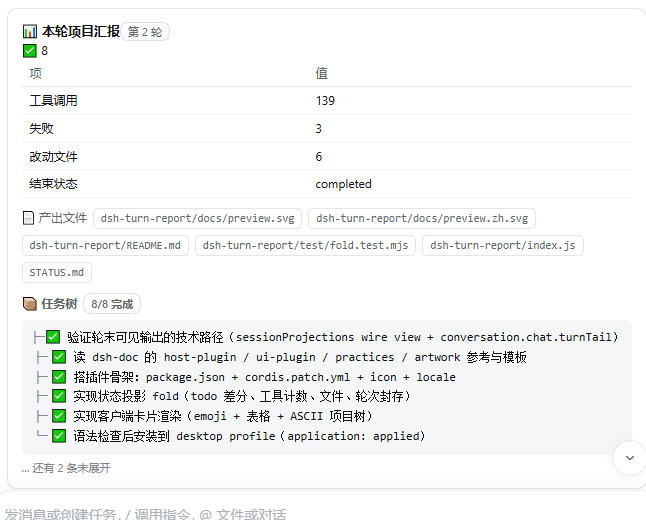

# Turn report

Adds a report card under every completed reply, plus a plan HUD inside it.
Everything is derived from the session log on the host — **no model calls, no token
cost, no files written**.



## What every turn gets

| Block | When it appears | Contents |
|---|---|---|
| 📋 Metrics | every turn | tool calls, failures (hidden when zero), files changed, end state |
| ⚙️ Execution | when the turn had model responses | model route, **call count**, input/output tokens, cache hit rate |
| 📄 Files | when the turn wrote files | workspace-relative paths, up to 6 |
| 📝 Finished | when the turn ticked items off | only what this turn newly completed |
| 🎮 Plan HUD | when the turn wrote a task list | progress bar + three foldable slots |

## The plan HUD

```
▰▰▰▰▰▰▰▰ 4/4  ✅ 4  ⏳ 0  ⬜ 0   ✨ All done
📋 Current plan
┌ ▼ ✅ Done  4
│  ✅ Fix the duplicated "next up" row
│  ✅ Draw a dashed rail at 0%
│  ✅ Update the README HUD section
│  ✅ Verify: syntax + assertions
┈ ⏳ In progress  0        ← dashed, dimmed, not clickable
┈ ⬜ To do  0
```

All three slots are always present, in a fixed order. A HUD whose slots come and go
reads as lost data; an empty slot that stays put reads as "nothing here right now".

## What it deliberately does not do

- **It does not repeat the full task list.** DSH already renders the live list in
  the built-in panel above the composer. This card reports the two facts that panel
  does not have: *what this turn finished*, and *what the plan looked like at the end
  of this turn*.
- **It does not require a task list every turn.** `todo_write` is the model's own
  judgement; forcing it would turn a "hello" into a pile of checkboxes. A turn with
  no plan simply gets no plan HUD.

## Honest limitations

- The "finished this turn" delta is computed by matching item text, because
  `todo_write` entries carry no stable id. List markers, whitespace and case are
  normalised away, so harmless rewording is handled — but a genuine rewrite reads as
  new work.
- Grouping is by status, not by the indentation in the task text. Measured against
  real sessions, `todo_write` payloads are flat: 0 of 5 items carried any indentation,
  so indentation-based grouping produced no groups at all.
- Only the last 15 turns keep cards; older ones scroll out of the projection window.
- The plan HUD is frozen per turn. If the model writes a list once and never updates
  it, the card will keep faithfully showing that stale list.

## Configuration

In the profile's `cordis.patch.yml`, overriding the same row (the whole `config` is
replaced, not deep-merged):

```yaml
- id: turn-report
  config:
    maxRows: 6              # rows for the tree and the finished list (hard cap 20)
    showWithoutTasks: true  # still show the card when the turn had no task list
    showTree: true          # allow the ASCII project tree
    showFiles: true         # list the files this turn touched
    showFinished: true      # show the "finished this turn" block
    showLlm: true           # show the model / calls / tokens summary line
    showStatusBar: true     # show the plan HUD
    todoView: auto          # auto | tree | both
```

## Install

```powershell
dsh plugin --profile desktop add file:"D:\path\to\dsh-turn-report"
```

Then restart DSH and refresh the page.

## Data sources

| Data | Source |
|---|---|
| Task list | `todo_write` snapshots (`todo/write`, whole-list replace) |
| Tool calls / failures | this turn's `tool/call`, `tool/result.message.isError` |
| Model / tokens | this turn's `assistant/message.usage` and `message.source` |
| Files changed | arguments of `write` / `edit` / `multi_edit` / `insert` / `str_replace_editor` |
| Turn bounds | `turn/start`, `turn/end` |