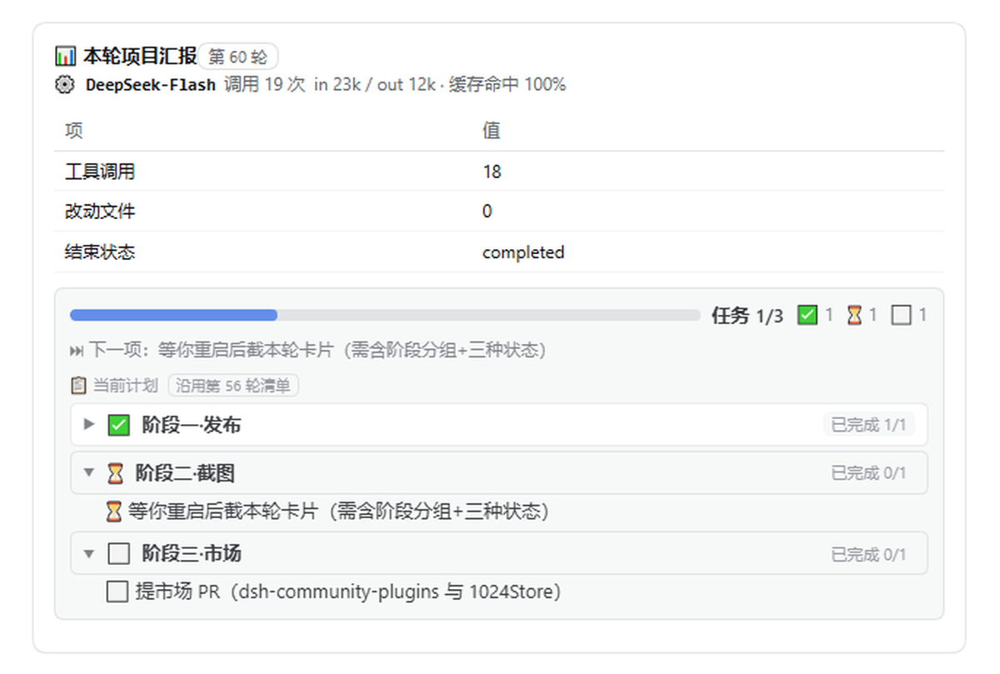

# 轮末项目汇报

在每一轮回复结束的位置加一张汇报卡，卡内含任务状态栏（HUD）。
所有数据都由宿主从会话日志推导——**不调用模型、不消耗 token、不写任何文件**。



## 每轮都会有的

| 区块 | 出现条件 | 内容 |
|---|---|---|
| 📋 指标 | 每一轮 | 工具调用、失败数（为 0 时隐藏）、改动文件数、结束状态 |
| ⚙️ 执行摘要 | 本轮有模型响应 | 模型、**调用次数**、输入/输出 token、缓存命中率 |
| 📄 产出文件 | 本轮改过文件 | 相对工作区路径，最多 6 个 |
| 💬 本轮决定 | 人明确说了决定 | **原话引用**，不做结构化提取 |
| 📝 本轮完成 | 本轮有新完成的项 | 只列这一轮新打勾的 |
| 🎮 计划 HUD | 会话里有任务清单 | 进度条 + 可折叠分组 |

### 💬 为什么引用原话，而不是解析

`todo_write` 记的是任务，不是意图。有人说「先建私有仓，明天再发 npm」，在下次写清单前，任务列表里没有任何痕迹——有时之后也没有。

引用原话是唯一诚实的做法：它补充了一个事实——第 N 轮有人说了这句话。

**不做结构化提取**，因为试过并失败了：正则从中文里提「动作 + 对象」，50 条真实发言只中 2 条，还错 1 条（「C 方向要做」→ 对象「方向」）。引用不可能误标动作，因为它根本不标注动作。

三道守卫，顺序很重要：先滤系统注入（真实会话里 145 条 `user/message` 有 92 条是系统文本，不是人在说话），再排疑问/假设/否定，最后收短消息（「做吧」「方案 E」恰恰是最清楚的决定）。同轮明确撤回会清空。

### 📋 三种「没有」是不同的

| 情况 | 卡片显示 |
|---|---|
| 本轮写了清单 | 该轮计划，无标记 |
| 本轮没写，但会话有清单 | 仍在生效的最近一份 + `沿用第 N 轮清单` |
| 本轮明确清空 | `本轮清空了任务清单` |
| 会话**从未**用过清单 | `本会话未使用任务清单` |

最后一条很关键：没有它，一个模型从不写清单的会话只显示指标表，看起来像插件坏了。

## 计划 HUD

**两种分组方式，按清单内容自动选择。**

**阶段模式**——清单项带 `【标签】` 前缀时，三个格子描述的是**阶段**而不是单个任务：

```
任务 2/5   ✅ 2  ⏳ 1  ⬜ 2
⏭ 下一项：搭插件骨架
📋 当前计划
┌ ▶ ✅ 阶段一·调研  已完成 2/2
┌ ▼ ⏳ 阶段二·实现  已完成 1/2
│  ⏳ 搭插件骨架
│  ⬜ 实现投影 fold
┌ ▼ ⬜ 阶段三·发布  已完成 0/1
```

阶段状态由它自己的任务决定：全完成 → ✅，有进行中 → ⏳，都没开始 → ⬜。
支持三种括号：`【阶段一·调研】`、`〔P1〕`、`[阶段2]`。

**状态模式**——没有阶段标记时，退回按任务状态分三组。

### 为什么阶段必须标注，不能推断

`todo_write` 没有阶段字段，实测载荷 100% 平铺（5 项里 0 项有缩进）。从数据反推不出阶段，所以由写清单的人标注。任何括号内容都算，不强加词汇表。

## 它怎么保持诚实

- 不写任何文件，状态全在会话投影里
- **改了视图输出就必须提升 `stateVersion`**，否则旧缓存会继续喂旧布局。这个坑踩过三次
- 卡片如实反映数据，包括「没有清单」——**它从不编造进度**。如果模型中途不再更新清单，卡片就显示陈旧的计数，因为那就是真相

## 计划 HUD

```
▰▰▰▰▰▰▰▰ 4/4  ✅ 4  ⏳ 0  ⬜ 0   ✨ 全部完成
📋 当前计划
┌ ▼ ✅ 已完成  4
│  ✅ 修复「下一项」与「进行中」组内容重复
│  ✅ 0% 进度条改为虚线框
│  ✅ 同步更新 README
│  ✅ 验证：syntax + 断言
┈ ⏳ 进行中  0        ← 虚线框、半透明、不可点
┈ ⬜ 待办  0
```

三个槽位**永远都在**，顺序固定。槽位时有时无会让人以为数据丢了；空槽留着才表示「此刻这里是 0」。

## 刻意不做的两件事

- **不重复完整任务清单**。DSH 输入框上方已有原生面板显示当前清单。
  这张卡只补它没有的两件事：**这一轮完成了什么**、**这一轮结束时计划长什么样**。
- **不强制每轮写清单**。调不调用 `todo_write` 是模型自己的判断，强行每轮写会让一句「你好」变成一堆复选框。没写清单的轮次就是没有 HUD。

## 诚实的边界

- 「本轮完成」按条目文本匹配，因为 `todo_write` 条目**没有稳定 id**。
  匹配前会剥掉列表符号、空白并忽略大小写，普通改写没问题——但**实质性改写措辞会被当成新工作**。
- 分组按**状态**，不按任务文本里的缩进。实测真实会话，`todo_write` 载荷全是平铺的
  （5 项里 0 项有缩进），按缩进分组会一个组都分不出来。
- 只保留最近 15 轮的卡片，更早的滚出投影窗口。
- 计划 HUD 是**逐轮快照**。如果模型只写一次清单、之后不更新，卡片就会一直如实显示那份旧清单。

## 配置

在 profile 的 `cordis.patch.yml` 里覆盖同一行（整份 `config` 替换，不是深合并）：

```yaml
- id: turn-report
  config:
    maxRows: 6              # 树和完成清单的行数（硬上限 20）
    showWithoutTasks: true  # 本轮没有任务清单时也出卡
    showTree: true          # 允许 ASCII 项目树
    showFiles: true         # 列改动文件
    showFinished: true      # 出「本轮完成」
    showLlm: true           # 出「模型 / 调用次数 / token」摘要行
    showStatusBar: true     # 出计划 HUD
    todoView: auto          # auto | tree | both
```

## 安装

```powershell
dsh plugin --profile desktop add file:"D:\path\to\dsh-turn-report"
```

装完重启 DSH，刷新页面。

## 数据来源

| 数据 | 来源 |
|---|---|
| 任务清单 | `todo_write` 快照（`todo/write`，整表覆盖） |
| 工具调用 / 失败 | 本轮 `tool/call`、`tool/result.message.isError` |
| 模型 / token | 本轮 `assistant/message.usage` 与 `message.source` |
| 改动文件 | `write` / `edit` / `multi_edit` / `insert` / `str_replace_editor` 的参数 |
| 轮次边界 | `turn/start`、`turn/end` |